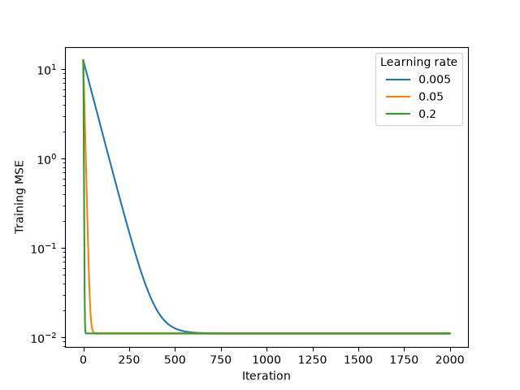
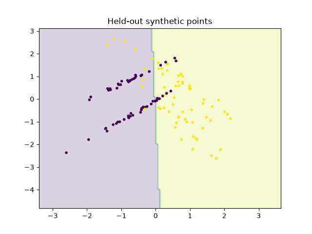
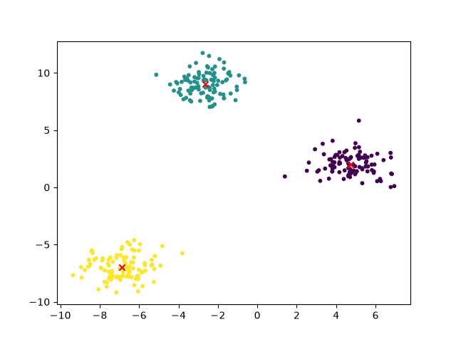
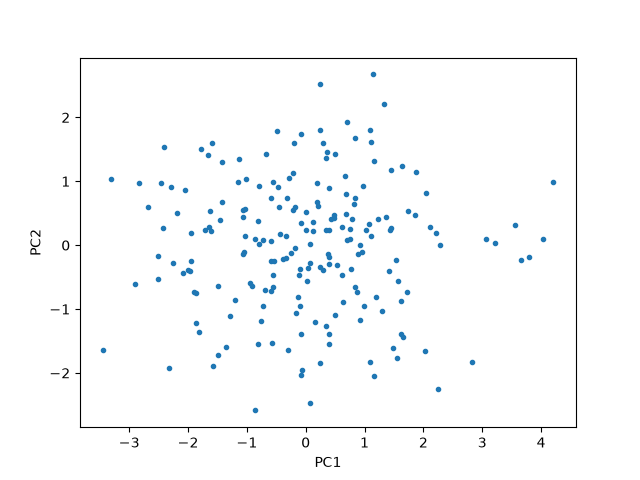
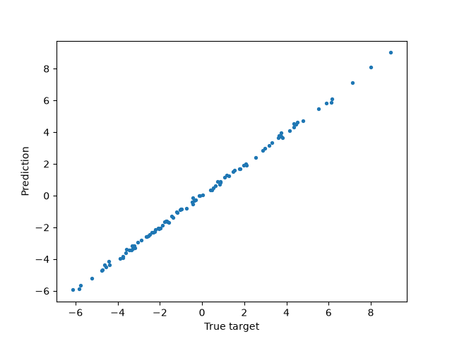

# Machine learning algorithms from first principles

NumPy implementations of linear regression, binary logistic regression, nearest neighbors, K-means and PCA, with analytical gradient checks and measured scikit-learn comparisons.

## Research question
How closely do explicit numerical implementations reproduce established estimators on controlled synthetic problems?

## Verified experiment
Seed 42; generated data, not real-world benchmarks. Train-only scaling and a held-out classification/regression split. Unsupervised methods compare decompositions of the same input, not predictive generalization.

| Measurement | Observed value |
|---|---:|
| Linear test MSE | 0.011106 |
| Largest prediction difference vs sklearn linear regression | 3.55e-15 |
| Logistic test F1 | 0.8308 |
| Logistic test ROC-AUC | 0.9160 |
| KNN Euclidean prediction agreement | 1.00 |
| PCA variance difference | 0 |

All measurements and configuration context: [metrics](results/synthetic/metrics.json).







## Reproduce
```bash
python -m venv .venv
source .venv/bin/activate
python -m pip install -e '.[dev]'
python -m first_principles.cli --seed 42 --output results/synthetic
pytest -q
ruff check .
ruff format --check .
```

`src/first_principles/models.py` contains the estimators; `cli.py` runs experiments. See [mathematics](docs/mathematics.md), [methodology](docs/methodology.md), [research report](docs/research_report.md) and [limitations](docs/limitations.md).

No sklearn estimator is used inside the custom algorithms. sklearn supplies datasets, metrics and reference implementations. K-means uses random sample initialization rather than sklearn's k-means++; logistic reference uses nearly unregularized C=1e8. Fixed iterations are not a universal convergence guarantee. Future work includes multiclass support and scalable distance search.

References: NumPy linear algebra documentation; scikit-learn estimator documentation; Lloyd (1982), *Least squares quantization in PCM*, IEEE TIT, DOI 10.1109/TIT.1982.1056489. MIT license; third-party libraries retain their own licenses.
